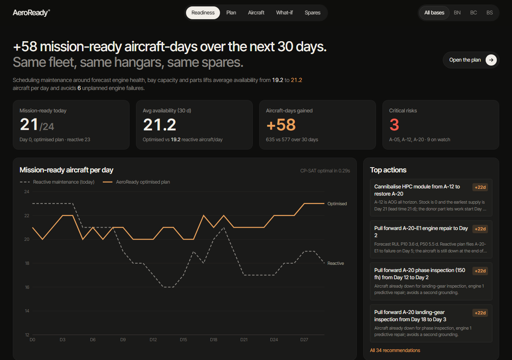
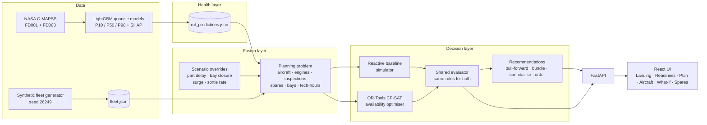
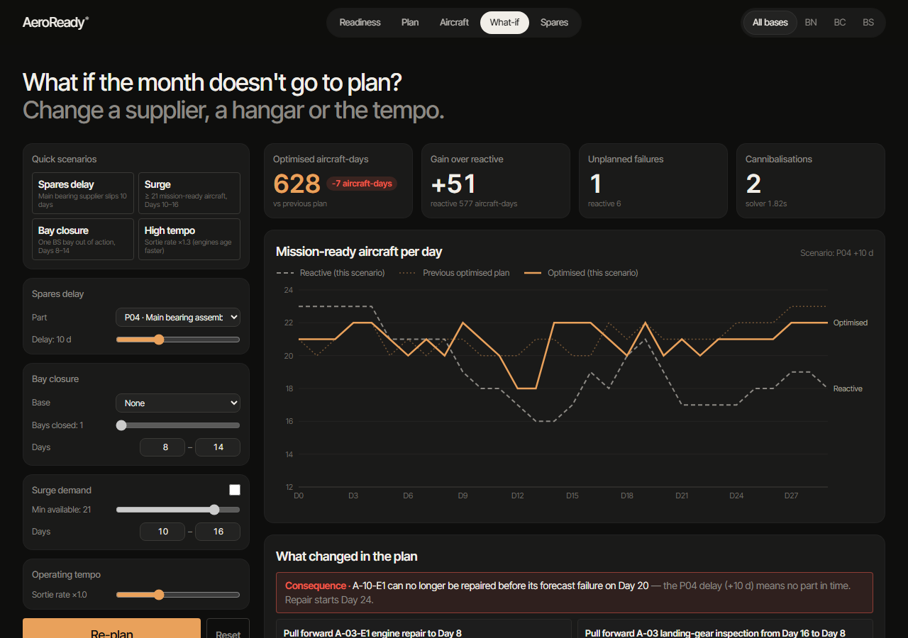

# AeroReady: availability-first predictive maintenance

**Smart India Hackathon 26249 · Air Power: Predictive Maintenance & Fleet Availability**
(Ministry of Defence / Defence Services Staff College)

> All fleet, base, spares and maintenance data in this prototype is **SYNTHETIC**.
> Engine sensor trajectories are real, from the NASA C-MAPSS turbofan dataset.




## The problem

Aircraft availability is low because maintenance is fragmented and reactive. Health
monitoring, technical records, spares and maintenance agencies are not integrated.
Faults are predicted late, parts are ordered after things break, and aircraft sit idle
in queues for hangar bays.

## The idea

Most predictive-maintenance tools stop at "here is a remaining-useful-life number".
AeroReady answers the commander's question instead:

> *How many aircraft can I put in the air each day for the next 30 days, and what should I change to raise that number?*

It forecasts engine health with uncertainty, joins that with inspections, spares and
hangar capacity in one data model, and then **optimises the whole fleet's maintenance
schedule for mission-ready aircraft-days**. A reactive baseline is scored against the
same data, the same horizon and the same rules, so the gain is a like-for-like number.

### Headline result (default scenario, deterministic)

| | Reactive (today) | AeroReady optimised |
|---|---:|---:|
| Mission-ready aircraft-days (30 d, 24 aircraft) | 577 | **635 (+58)** |
| Average aircraft available per day | 19.2 | **21.2** |
| Unplanned engine failures | 6 | **0** |
| Engine risk-days (flown past P10 forecast) | 55 | **5** |
| Downtime pushed past Day 29 | 2 | **0** |
| Cannibalisations | 0 | 2 |
| Capacity / parts violations | 0 | 0 |

CP-SAT proves the optimised plan **OPTIMAL in about 0.3 s**.

### What-if scenarios (all measured, `scripts/run_demo_check.py` and API)

| Scenario | Reactive | Optimised | Notes |
|---|---:|---:|---|
| Default | 577 | 635 | +58 |
| Main bearing (P04) supplier +10 days | 577 | 628 | A-10's engine can no longer be saved; 1 failure, −7 vs default |
| Surge: ≥ 21 aircraft, Days 10–16 | 577 (shortfall 26) | 635 (**shortfall 0**) | Optimiser meets the surge |
| One Southern-base bay closed, Days 8–14 | 572 | 635 | Optimiser absorbs the closure completely |
| Sortie rate ×1.3 (engines age faster) | 552 | 634 | 8 reactive failures → 0 |

## Architecture



### 1. Health layer: RUL with uncertainty (`backend/aeroready/rul`)
- Data: NASA C-MAPSS FD001 + FD003 (single operating condition; HPC and fan degradation).
- Preprocessing: near-constant sensors dropped (14 kept), 10-cycle rolling mean and std per sensor, piecewise-linear RUL target capped at 125 cycles.
- Three LightGBM quantile regressors (α = 0.1, 0.5, 0.9). Quantiles are sorted to prevent crossing.
- Cycles → days via each aircraft's sortie rate (configurable, with a scenario multiplier).
- Explainability: per-engine tree-SHAP contributions of the P50 model, aggregated per sensor.

**Test-set metrics** (official C-MAPSS test sets, last observed cycle per engine, truth capped at 125):

| Set | Engines | RMSE (P50) | MAE | NASA score | P10–P90 coverage (nominal 80%) | True RUL below P10 |
|---|---:|---:|---:|---:|---:|---:|
| FD001 | 100 | 17.73 | 12.80 | 596 | 77% | 16% |
| FD003 | 100 | 17.27 | 12.07 | 711 | 68% | 24% |

These numbers are typical for gradient boosting on C-MAPSS; sequence models reach RMSE ≈ 12–14.
The intervals are **somewhat too narrow**, especially on FD003, and are not yet calibrated (see Limitations).

### 2. Fusion layer: one data model (`backend/aeroready/fleet`)
Pydantic models for `Aircraft`, `Engine`, `Base`, `AgencyCapacity`, `MaintenanceTask`,
`Part`, `SparesStock` and `MaintenanceLogEntry`. The generator builds 24 aircraft across 3
bases (40 engines, each mapped to a distinct C-MAPSS test trajectory), 11 part types, 29
scheduled inspections and a 60-day log. It also plants documented tensions so the planner
has real trade-offs to resolve:

- **HPC module:** 0 in stock with a 21-day lead time, and A-20's engine is forecast to fail around Day 5.
- **A-12:** AOG for the whole horizon, holding a serviceable HPC module and radar T/R module.
- **A-20 bundling:** a phase inspection and a landing-gear inspection with overlapping windows.
- **Southern base bottleneck:** only 2 bays, with six inspections hard-due on Days 12–15.
- **Seal kit contention:** a single HPC seal kit wanted by two engines.
- **Bearing:** 0 in stock with a 14-day lead time.
- **Radar defect:** due Day 6, but the only inbound part arrives Day 9.

### 3. Optimiser: CP-SAT (`backend/aeroready/optimizer`)
Time-indexed model, horizon 30 days, one boolean per (job, start day, part source).

**Jobs**
- Scheduled inspections, which start within their window; authorised deferral is penalised.
- Predictive engine repairs, generated from the RUL forecast.
- Corrective repairs, which only exist if the engine fails.

**Failure model.** An engine fails on day ⌊P50⌋ unless preventive work starts before it. A failed engine grounds its aircraft and needs a longer repair (6 days instead of 3) plus the part.

**Constraints**
- **Bay capacity:** one bay per aircraft in work, so jobs on the same aircraft that overlap count as one grounding (bundling).
- **Technician hours:** a daily limit per base.
- **Parts:** supply = stock + inbound until the lead time, then anything ordered on Day 0. A part can also be cannibalised from an aircraft that is grounded for the whole horizon (from Day 1), which raises a linked removal record.
- **Overdue inspections:** an inspection not started by its hard limit grounds the aircraft.

**Objective.** Maximise mission-ready aircraft-days, minus penalties for:
- risk-days (flying past P10),
- deferral,
- cannibalisation,
- unplanned failures,
- surge shortfall (a soft minimum per day, high weight).

**Fairness guards.** Inspections due inside the horizon cannot be pushed past it, and downtime that spills past Day 29 is charged. Without these, the optimiser could "win" by exporting work beyond the horizon.

**Solver.** Deterministic: a single worker with `linearization_level=2`, a fixed seed, and a 10 s limit. It typically proves optimality in under 1 s.

**Reactive baseline**
- Inspections are inducted at their due date.
- Engines fly to failure (the same forecast failure day).
- Bays go first-come-first-served.
- Parts for failures are ordered only when the failure happens.
- No cannibalisation.

**Shared evaluator.** Both plans are scored by one evaluator that also checks every constraint. The solver's own aircraft-day count must equal the evaluator's, or the API raises an error.

### 4. API (`backend/aeroready/api/main.py`)
| Endpoint | Purpose |
|---|---|
| `GET /api/fleet` | Aircraft with green/amber/red status, RUL bands and next task |
| `GET /api/aircraft/{id}` | Health, RUL history, sensor trends, contributions, log, tasks, timelines, recommendations |
| `GET /api/plan` | Cached default plan (baseline + optimised) |
| `POST /api/plan` | Re-plan with scenario overrides (`part_delays`, `bay_closures`, `surge`, `sortie_rate_multiplier`) |
| `GET /api/spares` | Stock, inbound, demand, shortages, Day-0 orders, cannibalisations |
| `GET /api/meta` | Bases, parts, planted tensions, RUL metrics |

Interactive docs are at http://localhost:8000/docs.

## How to run

Prerequisites: Python 3.11+ (tested on 3.12), Node 20+ (tested on 22).

**Quick start (Windows, one command):**
```powershell
.\start.ps1          # sets up venv + npm packages if needed, builds the UI, serves everything at http://localhost:8000
.\start.ps1 -Dev     # API on :8000 with reload + Vite hot-reload UI on :5173
```
When `frontend/dist` exists, the FastAPI process serves the UI too, so the demo needs only one server.

**Manual setup: backend** (first time):
```bash
cd backend
python -m venv .venv
.venv/Scripts/python -m pip install -r requirements.txt     # macOS/Linux: .venv/bin/python
.venv/Scripts/python scripts/download_cmapss.py             # NASA C-MAPSS (~12 MB)
.venv/Scripts/python scripts/generate_fleet.py              # synthetic fleet -> data/fleet.json
.venv/Scripts/python scripts/train_rul.py                   # train RUL models, print metrics (~20 s)
.venv/Scripts/python scripts/run_demo_check.py              # baseline vs optimised, asserts optimised >= baseline
.venv/Scripts/python -m pytest                              # 13 tests
```
`data/fleet.json`, `data/rul_predictions.json` and the trained models are committed, so the API runs without the download and training steps.

**Run the backend:**
```bash
cd backend && .venv/Scripts/python -m uvicorn aeroready.api.main:app --port 8000
```

**Run the frontend:**
```bash
cd frontend && npm install && npm run dev       # http://localhost:5173 (proxies /api to :8000)
```

> **Windows note:** with Smart App Control enabled, the newest pandas (3.x) and OR-Tools
> (9.15) wheels are blocked from loading their DLLs. `requirements.txt` pins versions that load.

## Screenshots

| Plan (Gantt + recommendations) | Aircraft detail |
|---|---|
|  |  |
| **What-if** | **Spares** |
|  |  |

## Limitations (honest list)

- **Synthetic fleet.** Bases, inspections, spares, lead times and logs are invented. The size of the gain depends on the planted tensions; it shows the mechanism, not a forecast of real-world benefit.
- **C-MAPSS is a simulation** of a commercial turbofan, not a military engine, and has no maintenance actions inside its trajectories.
- **RUL intervals are under-covered** (68–77% against a nominal 80%), and 16–24% of true RULs fall below P10. The planner treats P10 as a risk threshold, so this matters. Conformal calibration is the next step.
- **Deterministic failure model.** Engines are assumed to fail on the P50 day in both plans. The plan is not yet stress-tested against the forecast distribution (e.g. Monte Carlo over the RUL quantiles).
- **Model misses carry through.** The planner deliberately uses the forecast, not the truth. In this fleet the model is late on A-18-E1 and A-14-E1, and raises a likely false alarm on A-01-E2 (true RUL 114 cycles), which the optimiser repairs in a bundle at zero availability cost.
- **Simplified logistics.** Spares are fleet-pooled with same-day transfer, there is a single engine-repair part per engine, and no transport or crew rostering.
- **30-day horizon effects** are mitigated (carry-over and spill-over penalties) but not eliminated.
- **Per-aircraft impact.** Recommendation impact is reported per aircraft (optimised minus reactive days for that tail), not as an exact marginal value for each action.

## Next steps

1. **Real data integration:** HUMS/engine-monitoring feeds, the maintenance information system (technical records), the spares ERP, and agency capacity rosters through the same pydantic contract.
2. **Validation with maintenance engineers:** review the recommendations against AMM/inspection rules and deferral authority, and run shadow-mode comparison against actual schedules.
3. **Uncertainty-aware planning:** calibrated (conformal) intervals, Monte-Carlo plan robustness and chance constraints on failure risk.
4. **Security accreditation:** on-premises deployment, an air-gapped model registry, role-based access and audit trails before any operational data touches the system.
5. **Richer model:** multi-echelon spares, transport lead times, technician trades and shifts, and mission tasking by aircraft role.

## Repository layout

```
backend/
  aeroready/
    rul/          C-MAPSS loading, features, LightGBM quantile training, inference + SHAP
    fleet/        pydantic data model, synthetic generator, JSON store
    optimizer/    problem builder, CP-SAT model, reactive baseline, evaluator, recommendations
    api/          FastAPI app
  scripts/        download_cmapss.py · generate_fleet.py · train_rul.py · run_demo_check.py
  tests/          fleet, RUL, optimiser (capacity, parts, bundling, determinism), API
  data/           fleet.json, rul_predictions.json, rul_metrics.json, models/
frontend/         React + Vite + TypeScript + Tailwind + Recharts
docs/screenshots/
DEMO.md           3-minute demo script
```


Landing photos: Samuel Arkwright and Mihai Neagu, via Unsplash (Unsplash licence).
