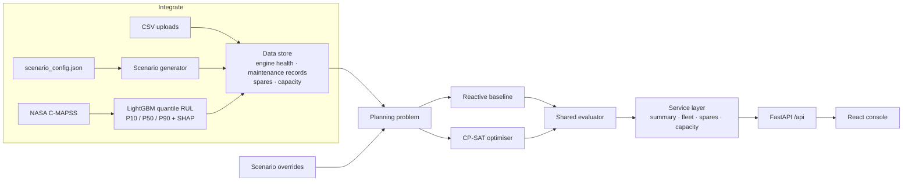
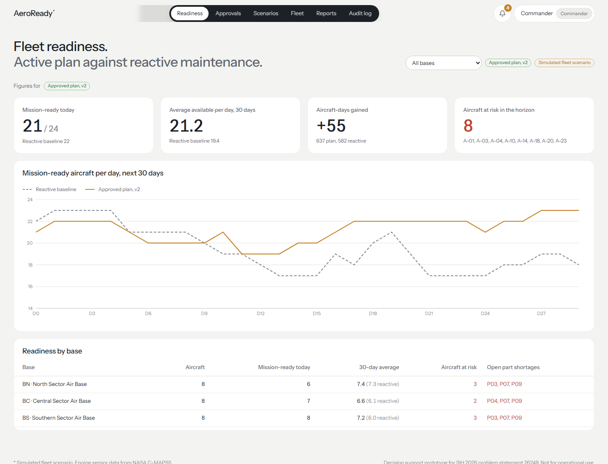
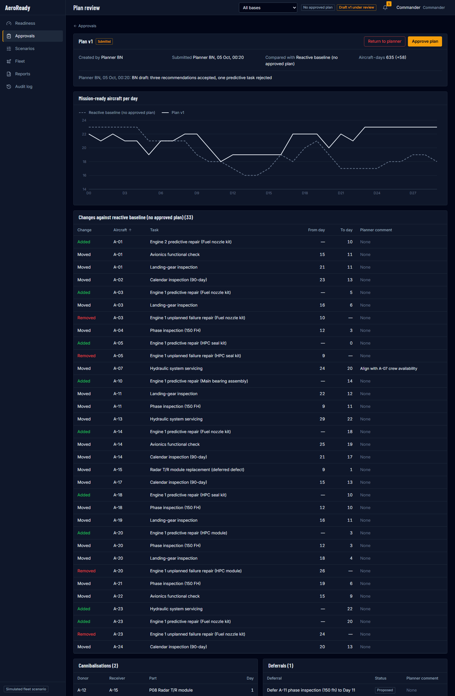
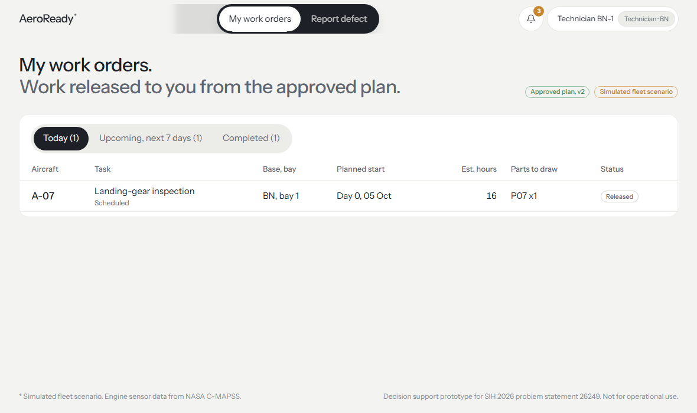
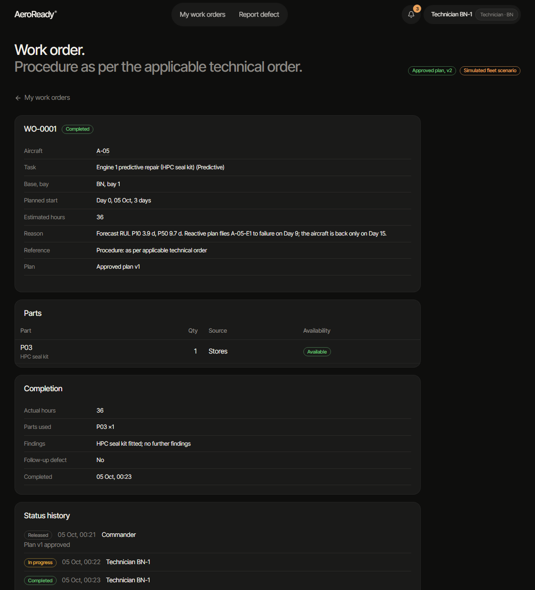
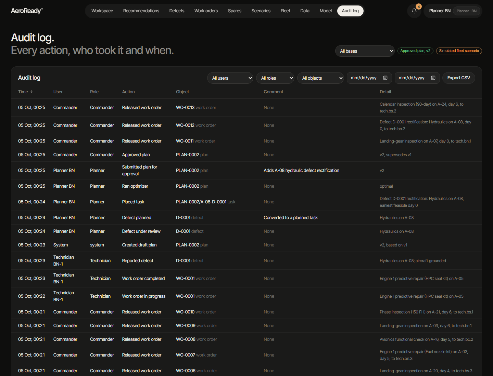

# AeroReady: availability-first predictive maintenance

**Smart India Hackathon 2026 · Problem statement 26249 · Air Power – Predictive Maintenance & Fleet Availability**
(Ministry of Defence / Defence Services Staff College)

AeroReady predicts engine life, then schedules maintenance for the whole fleet within hangar, technician and
spares limits to keep the most aircraft mission-ready. It answers the commander's question:

> *How many aircraft can I put in the air each day for the next 30 days, and what should I change to raise that number?*

The optimiser proposes; people decide. A planner reviews and adjusts the proposal, the commander approves it, and
approved work becomes work orders for technicians, whose completions and defect reports feed the next plan.


The visual design is a light theme built around the hero reference: a full-bleed photographic hero with a very large wordmark, a dark GooeyNav pill navigation, SideRays light in the section after the hero, two-tone headings and rounded white panels. Photos by Samuel Arkwright and Mihai Neagu (Unsplash licence), stored locally in `frontend/public/img`. Project rules are in [`CLAUDE.md`](CLAUDE.md).

## What is real and what is simulated

| | Source | Status |
|---|---|---|
| Engine sensor trajectories and true remaining life | NASA C-MAPSS turbofan degradation data (FD001, FD003) | **Real (public dataset)** |
| RUL forecasts, P10/P50/P90 | LightGBM quantile models trained and tested on C-MAPSS | **Computed** from the real data |
| Fleet composition, bases, sortie rates | Seeded scenario generator | **Simulated** |
| Scheduled inspections, deferred defects, maintenance log | Seeded scenario generator | **Simulated** |
| Spares stock, inbound deliveries, lead times | Seeded scenario generator | **Simulated** |
| Hangar bays and technician hours | Seeded scenario generator | **Simulated** |

Every assumption behind the simulated scenario is in one file,
[`backend/aeroready/fleet/scenario_config.json`](backend/aeroready/fleet/scenario_config.json). The generator reads it,
and the console's **Data sources** page displays it. The UI labels this data "Simulated fleet scenario". Any of the
four sources can be replaced with your own CSV on that page; the label then changes to "Uploaded data".

The UI shows no hardcoded figures. Every metric, chart point and table row comes from the API. Model metrics are read
from the saved evaluation of the training run (`backend/data/rul_metrics.json`, `rul_test_predictions.json`).

## Sign-in, roles and workflow

Every page except `/login` requires sign-in. Sessions last 8 hours (JWT, HS256; secret in `backend/data/secret.key`,
generated on first run, or the `AERO_SECRET` environment variable). Passwords are stored as bcrypt hashes in
`backend/data/users.json`, which the scenario generator creates: one commander, and per base one planner and three
technicians. Role checks run on the backend for every endpoint; the UI only hides what a role cannot use.

### Demo accounts

The password for every account is the username followed by `-26249`. These are listed here only, never in the UI.

| Username | Password | Role | Base |
|---|---|---|---|
| `commander` | `commander-26249` | Commander | All |
| `planner.bn` · `planner.bc` · `planner.bs` | `planner.bn-26249` etc. | Planner | BN · BC · BS |
| `tech.bn.1` … `tech.bn.3` | `tech.bn.1-26249` etc. | Technician | BN |
| `tech.bc.1` … `tech.bc.3` | `tech.bc.1-26249` etc. | Technician | BC |
| `tech.bs.1` … `tech.bs.3` | `tech.bs.1-26249` etc. | Technician | BS |

### Workflow

1. **Planner** runs the optimiser, creating a draft plan (v1, v2, …). Each recommendation is Proposed and can be
   Accepted (task locked), Modified (moved to another day after a constraint check) or Rejected (reason required; the
   optimiser re-solves without it). Planners can move, lock or remove tasks at their own base only; a move that breaks
   a constraint is refused with the specific violation, for example "Base BN has 4 of 4 bays occupied on day 12".
2. Planner submits the draft. **Commander** reviews it against the approved plan (or the reactive baseline): daily
   availability, every added, moved or removed task with planner comments, cannibalisations, deferrals and engine work
   accepted after its P10 forecast. The commander approves it or returns it with a required comment.
3. On approval the plan becomes the single active plan (the previous one is superseded), and every task starting in
   the next 7 days becomes a **work order** for a technician at that base.
4. **Technician** starts, pauses and completes work orders (actual hours, parts used, findings), marks them cannot
   complete (reason required), or reports a defect. A defect marked not serviceable grounds the aircraft at once.
5. Defects notify the base planner and the commander and open a re-plan draft. The planner reviews the defect,
   converts it to a planned task on the earliest feasible day, re-runs the optimiser and submits again.

Status models: plan Draft, Submitted, Approved or Returned; recommendation Proposed, Accepted, Modified or Rejected;
work order Released, In progress, Paused, Completed or Cannot complete; defect Reported, Under review, Planned or Closed.
Every action is written to the audit log (who, role, action, object, time, comment), viewable and exportable at `/audit`.
Workflow state is kept in `backend/data/state/` (delete the folder to start over).

## Site map

```
/                              Landing page: problem, how it works, roles, data and method
/login                         Sign-in
/commander                     Readiness: pending approval banner, stat tiles, 30-day availability, readiness by base
/commander/approvals[/:id]     Plan list; plan review with approve or return
/commander/scenarios           What-if builder, surge target check, saved scenarios
/commander/fleet[/:tail]       Fleet table and aircraft detail (read only)
/commander/reports             Date-range readiness report; export PDF (print) and CSV
/planner                       Planning workspace: draft header, availability vs approved, Gantt with locks, task panel, capacity heatmap
/planner/recommendations       Recommendation queue: accept, modify, reject with reason, bulk accept
/planner/defects               Defects: review, convert to planned task, close with reason
/planner/work-orders           Work orders: status, technician, reassign, re-plan cannot-complete orders
/planner/spares | scenarios | fleet | data | model
/technician                    My work orders: Today, Upcoming (next 7 days), Completed
/technician/work-orders/:id    Work order detail: start, pause, complete, cannot complete, status history
/technician/defects/new        Report defect
/technician/aircraft/:tail     Aircraft status, open work orders, completed work, engine RUL band
/audit                         Audit log with filters and CSV export (commander and planner)
/dev/ui                        Shared UI components (not linked)
```

## Headline result (default scenario, deterministic)

| | Reactive baseline | Optimised plan |
|---|---:|---:|
| Mission-ready aircraft-days (30 days, 24 aircraft) | 577 | **635 (+58)** |
| Average aircraft available per day | 19.2 | **21.2** |
| Unplanned engine failures | 6 | **0** |
| Engine risk-days (flown past the P10 forecast) | 55 | **5** |
| Capacity or parts violations | 0 | 0 |

CP-SAT proves the plan optimal in about a second. The reactive baseline and the optimised plan are scored by the same
evaluator, with the same data, horizon and rules.

## How it works



1. **Integrate data.** Four sources (engine health, maintenance records, spares, maintenance capacity) are loaded into one pydantic data model. Uploaded CSVs are validated against each source's schema, row by row, before anything changes.
2. **Predict component life.** LightGBM quantile models (alpha 0.1/0.5/0.9) on C-MAPSS FD001+FD003. Near-constant sensors are dropped; rolling mean/std features are used; RUL is capped at 125 cycles. Cycles convert to days through each aircraft's sortie rate.
3. **Optimise the fleet schedule.** A time-indexed CP-SAT model chooses start days for inspections and engine work within:
   - bays per base (overlapping jobs on one aircraft use one bay)
   - technician hours
   - parts: stock and inbound deliveries until the lead time, with cannibalisation from aircraft grounded all horizon
   - inspection windows with authorised deferral
   - forecast failures, which ground the aircraft and need a longer repair

   The objective is mission-ready aircraft-days, minus penalties for:
   - flying past P10
   - deferrals
   - cannibalisation
   - failures
   - surge shortfall
   - work pushed past the horizon
4. **Test scenarios.** Part delays, bay closures, surge targets and per-base or per-aircraft sortie rates re-run the whole pipeline. Saved scenarios are stored on the backend in `backend/data/scenarios.json`.

### Model metrics (official C-MAPSS test sets, last observed cycle per engine)

| Set | Engines | RMSE | MAE | NASA score | P10–P90 coverage (nominal 80%) | True RUL below P10 (nominal 10%) |
|---|---:|---:|---:|---:|---:|---:|
| FD001 | 100 | 17.73 | 12.80 | 596 | 77% | 16% |
| FD003 | 100 | 17.27 | 12.07 | 711 | 68% | 24% |

## API

All routes are under `/api` and need a bearer token except `/health` and `/auth/login`; interactive docs are at `/docs`.
Main groups: `auth`, `plans` (create, optimise, decide recommendations, check/move/lock/remove tasks, submit, return,
approve, review), `summary`, `readiness/by-base`, `fleet`, `aircraft`, `capacity`, `spares`, `reports/readiness`,
`plan` and `scenarios` (what-if), `work-orders`, `defects`, `technician/aircraft`, `notifications`, `audit`, `users`,
`data`, `model`. Each endpoint declares the roles allowed to call it in `backend/aeroready/api/main.py`.

The frontend reads the API base URL from `VITE_API_BASE` (default `/api`; see `frontend/.env.example`).

## How to run

Prerequisites: Python 3.11+ (tested on 3.12) and Node 20+ (tested on 22).

**One command (Windows):**
```powershell
.\start.ps1          # creates the venv and installs packages if needed, builds the UI, serves everything at http://localhost:8000
.\start.ps1 -Dev     # API on :8000 with reload + Vite dev server on :5173
```

**Manual:**
```bash
cd backend
python -m venv .venv
.venv/Scripts/python -m pip install -r requirements.txt     # macOS/Linux: .venv/bin/python
.venv/Scripts/python -m uvicorn aeroready.api.main:app --port 8000

cd frontend
npm install
npm run dev                                                 # http://localhost:5173, proxies /api to :8000
```

**Rebuild data and models (optional; the outputs are committed):**
```bash
cd backend
.venv/Scripts/python scripts/download_cmapss.py   # NASA C-MAPSS, about 12 MB
.venv/Scripts/python scripts/generate_fleet.py    # simulated fleet from scenario_config.json
.venv/Scripts/python scripts/train_rul.py         # trains, evaluates, saves metrics and test predictions
.venv/Scripts/python scripts/run_demo_check.py    # baseline vs optimised; asserts optimised >= baseline
.venv/Scripts/python -m pytest                    # 15 tests
```

> **Windows note:** with Smart App Control enabled, the newest pandas (3.x) and OR-Tools (9.15) wheels are blocked
> from loading their DLLs. `requirements.txt` pins versions that load.

## Screenshots

| Landing page | Sign-in |
|---|---|
|  |  |
| **Commander readiness** | **Plan review** |
|  |  |
| **Fleet status** | **Aircraft detail** |
|  |  |
| **Technician work orders** | **Work order** |
|  |  |
| **Audit log** | |
|  | |

## Limitations

- **Not validated on real IAF data.** The fleet is simulated. The size of the gain depends on the scenario's deliberate tensions (`planted` in the config); it shows the mechanism, not a forecast of real-world benefit.
- **C-MAPSS simulates a commercial turbofan**, not a military engine, and its trajectories contain no maintenance actions.
- **RUL intervals are too narrow.** P10–P90 coverage is 68–77% against a nominal 80%, and 16–24% of true RULs fall below P10. The planner treats P10 as a risk threshold, so this matters. Conformal calibration is the next step.
- **Deterministic failure model.** Engines are assumed to fail on the P50 day in both plans; the plan is not stress-tested against the forecast distribution.
- **Model misses carry through.** The planner uses the forecast, not the truth. The model is late on A-18-E1 and A-14-E1, and probably raises a false alarm on A-01-E2.
- **Simplified logistics.** Spares are fleet-pooled with same-day transfer, each engine has one repair part, and there is no transport or crew rostering.
- **Recommendation impact** is reported per aircraft (that tail's optimised minus reactive days), not as a marginal value per action. Cannibalisation actions on the Spares page do show a true marginal value (the plan is re-solved without that donor part).
- **Uploaded engine health** replaces forecast values only; the RUL history chart and sensor attributions still come from the trained model.

## Next steps

1. Integration with real systems: health and usage monitoring, maintenance information system, logistics ERP and agency rosters, through the same schemas the upload page validates.
2. Validation with maintenance engineers: review recommendations against inspection rules and deferral authority, and run the planner in shadow mode against actual schedules.
3. Calibrated intervals and robustness testing: conformal prediction, and Monte Carlo over the RUL quantiles with chance constraints on failure risk.
4. Security accreditation before any operational data is used: on-premises deployment, integration with the service identity system in place of the local user file, and tamper-evident audit storage.

## Repository layout

```
backend/
  aeroready/
    rul/            C-MAPSS loading, features, quantile training and evaluation, inference + SHAP
    fleet/          pydantic data model, scenario_config.json, generator, JSON store
    optimizer/      problem builder, CP-SAT model, reactive baseline, evaluator, recommendations
    datastore.py    four data sources, CSV templates, validation, uploads, reset
    scenarios.py    saved scenarios (data/scenarios.json)
    service.py      plan cache and derived views (summary, fleet, aircraft, spares, capacity)
    users.py, auth.py   generated users (bcrypt), JWT sessions, role checks
    planning.py     versioned plans, recommendation decisions, task moves, submit, return, approve
    workflow.py     work orders, defects, notifications, audit log
    opstate.py      JSON state stores (data/state/); folds completed work and defects into planning
    api/main.py     FastAPI routes; serves frontend/dist when built
  scripts/          download_cmapss · generate_fleet · train_rul · run_demo_check
  tests/            fleet, RUL, optimiser, API (roles, full plan-to-work-order workflow, uploads, scenarios, model)
frontend/           React + Vite + TypeScript + Tailwind + Recharts + TanStack Query + lucide-react
docs/screenshots/
DEMO.md             3-minute demo script
start.ps1           one-command launcher
```
